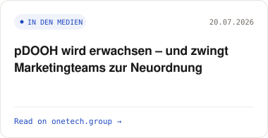
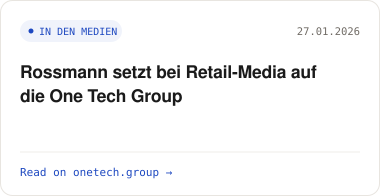
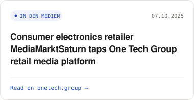

<a href="https://onetech.group">
  <picture>
    <source media="(prefers-color-scheme: dark)" srcset="./assets/header-dark.svg">
    
  </picture>
</a>

  <a href="https://onetech.group"><picture><source media="(prefers-color-scheme: dark)" srcset="./assets/btn-web-dark.svg"></picture></a>
  <a href="https://onetech.group/careers"><picture><source media="(prefers-color-scheme: dark)" srcset="./assets/btn-careers-dark.svg"></picture></a>
  <a href="https://onetech.group/contact"><picture><source media="(prefers-color-scheme: dark)" srcset="./assets/btn-contact-dark.svg"></picture></a>

We enable publishers to sell, manage and optimize their ad spaces with a consolidated platform — across DOOH, OOH, Print and Radio.

### Four products. One platform.

<picture>
  <source media="(prefers-color-scheme: dark)" srcset="./assets/products-dark.svg">
  
</picture>

<picture>
  <source media="(prefers-color-scheme: dark)" srcset="./assets/channels-dark.svg">
  
</picture>

### Newsroom

<!-- NEWS:START -->

<a href="https://onetech.group/pdooh-wird-erwachsen-und-zwingt-marketingteams-zur-neuordnung/"><picture><source media="(prefers-color-scheme: dark)" srcset="./assets/news-1-dark.svg"></picture></a>
<a href="https://onetech.group/rossmann-setzt-bei-retail-media-auf-die-one-tech-group/"><picture><source media="(prefers-color-scheme: dark)" srcset="./assets/news-2-dark.svg"></picture></a>
<a href="https://onetech.group/consumer-electronics-retailer-mediamarktsaturn-taps-one-tech-group-retail-media-platform/"><picture><source media="(prefers-color-scheme: dark)" srcset="./assets/news-3-dark.svg"></picture></a>

<!-- NEWS:END -->

Latest from <a href="https://onetech.group">onetech.group</a>, updated daily.

### Work with us

We build programmatic advertising for DOOH and Retail Media in Düsseldorf. Flat hierarchies, cross-functional teams, direct access to decision-makers. → [Open roles and unsolicited applications](https://onetech.group/careers)
